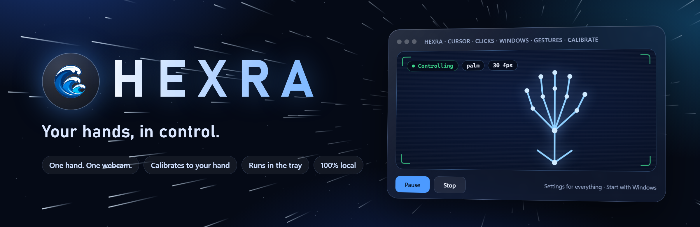

# 🖐️ Hexra

<div align="center">

<p align="center">
  
</p>

<p align="center">
  
</p>

```
 _   _ _______  ______      _
| | | | ____\ \/ /  _ \    / \
| |_| |  _|  \  /| |_) |  / _ \
|  _  | |___ /  \|  _ <  / ___ \
|_| |_|_____/_/\_\_| \_\/_/   \_\
```

### Your hands, in control.

**Hexra turns one hand and a webcam into your mouse: move the cursor, click, drag, right-click, scroll in four directions and throw windows around, across every screen you own.**  
*No gloves. No special camera. No cloud. One 89 MB installer.*

---

[](https://github.com/sudheer-050/hexra/releases/latest)
[](https://www.python.org/)
[]()
[-brightgreen.svg?logo=pytest&logoColor=white)]()
[](https://developers.google.com/mediapipe)
[]()
[](LICENSE)

[⬇️ Download](#-download-and-install) • [Gestures](#-the-six-gestures) • [What It Does & Doesn't](#-overview-what-it-does-vs-what-it-doesnt-do) • [Why It Feels Like a Mouse](#-why-it-feels-like-a-mouse) • [Who Is This For?](#-who-is-this-for) • [Run From Source](#-run-from-source) • [Settings](#-settings) • [How It Works](#-how-it-works) • [Honest Limits](#-honest-limits)

</div>

---

## ⬇️ Download and Install

1. Grab **`Hexra-Setup.exe`** from the [latest release](https://github.com/sudheer-050/hexra/releases/latest) (about 89 MB, everything inside, nothing else to download).
2. Double-click it. Windows may say *"Windows protected your PC"* because the file is not code-signed: click **More info → Run anyway**.
3. Start **Hexra** from the desktop or Start Menu. Hold an **open palm in the air for 1 second** to wake it, press **F8** to engage, press **F9** to quit.

Want to look before you touch? Start **"Hexra (try it, mouse untouched)"** from the Start Menu: it shows what it sees and never moves your mouse.

> 📘 The release also ships a **31-page illustrated guide** (`Hexra-Guide.pdf`): how to use it, how it works inside, and the whole story of how it was built.

---

## 🖐️ The Six Gestures

| Hand shape | How | What happens |
| :--- | :--- | :--- |
| ✋ **Open palm** | fingers straight, spread a little | **Moves the cursor** (also the 1-second wake gesture) |
| ☝️ **One finger** | only the index finger up | **Pauses the cursor**. Like lifting a mouse to reposition |
| 🤏 **Pinch** | thumb tip meets index tip | **Left click**. Keep pinching and move to **drag** |
| 🤟 **Three fingers** | index + middle + ring up | **Right click** |
| ✌️ **Two fingers** | index + middle up, move your hand | **Scroll** up, down, left, right |
| ✊ **Fist** | fingers clearly closed | **Grab the window under the cursor** and move it |

Every shape is different from every other, and anything the program is unsure about counts as *open palm*, which can only move the cursor. A shaky frame can never click or grab.

### 🪟 Window commands (new)

Three more poses act on the **window under the cursor**. Each is a *held* pose: a ring fills in the camera window, nothing happens until it is full, and dropping the pose cancels it. No pose is shared with a movement gesture.

| Hand shape | Hold | What happens |
| :--- | :--- | :--- |
| 👍 **Thumbs-up** (fist with the thumb sticking straight up, clearly beyond the fist) | 0.5 s | **Maximise**, or restore if it is already maximised |
| 👎 **Thumbs-down** (fist with the thumb pointing straight down, below the wrist) | 0.5 s | **Minimise** |
| 🤙 **L shape** (thumb out sideways, index up, rest closed) | 1.5 s, red ring | **Close**: the same as clicking the window's X, so the program can still ask to save |
| ✊ **Fist, dragged INTO a screen edge, then opened** | release | **Snap**: left or right edge = that half of the screen (split screen), top edge = maximise. A live hint shows while you are in the zone. A window grabbed at the edge (a title bar near the top) and let go there does not snap |

Safety: they never act on the desktop, the taskbar or Hexra's own windows; they cannot start while you hold a fist or a pinch; a fist only takes hold of a window **once your hand moves** (about 30 pixels), so the fist on the way to a thumbs-up touches nothing; and a fist cannot grab a window for a moment after a thumbs pose, so a hand relaxing out of a thumbs-up grabs nothing. Switch snapping off with `snap_edges: false`; change holds in `config.yaml`.

---

## 🎯 Overview: What It Does vs. What It Doesn't Do

### ✅ What Hexra Does

* **Mouse-like movement:** the cursor moves by how far your hand moves, with acceleration. Slow hand = pixel-fine control, quick flick = across the screen.
* **Adaptive smoothing:** a One-Euro filter calms a trembling hand when you are still and gets out of the way when you move fast.
* **Click that lands where you aimed:** the pinch itself pushes your hand. The click is placed where the cursor was just *before* the pinch began.
* **Window grab by pointing:** make a fist anywhere and the window **under your cursor** (not just the front one) follows your hand.
* **Window commands:** thumbs-up maximises, thumbs-down minimises, a held L closes, and a fist dragged to a screen edge snaps the window to half the screen or maximises it.
* **Every screen at once:** left, right, above, below, different sizes and DPI. The whole desktop is one area.
* **Only when you face the screen (optional):** turn your head away to talk to a friend or look at your phone and Hexra pauses by itself; look back and it carries on. It reads your head turn from a tiny face detector, runs on a background thread, and does not identify you. Switch it on with `attention: enabled: true`.
* **In-the-air only:** a hand resting on a desk, your lap or your head is ignored. It starts asleep and wakes with a 1-second open palm.
* **Stable holds:** a click-drag or a grabbed window survives pose flicker, motion blur and brief tracking loss.
* **Optional admin face lock:** gestures only work while your enrolled face is recognised (in the source; off in the installer build).
* **Tested without a camera:** the state machine has no camera or OS calls inside, so all 139 tests run anywhere.

### ❌ What It Does NOT Do

* **Does NOT send anything anywhere.** No cloud, no account, no telemetry. Camera frames live in memory for one frame.
* **Does NOT save photos.** The optional face lock stores 128 numbers per sample, never images.
* **Does NOT pretend to be a real mouse.** A webcam delivers 30 frames per second with 50–100 ms of its own delay. The software adds roughly 15–30 ms; the hardware floor is not something code can remove.
* **Does NOT do two cursors.** Windows has exactly one system cursor.
* **Does NOT use more than one camera.** A stereo multi-camera version was built and then removed; it is kept in [`archive/multicam`](archive/multicam).
* **Does NOT run on macOS or Linux yet.** The window mover, DPI and monitor code use Windows APIs.

---

## 🏆 Why It Feels Like a Mouse

| Pillar | The naive webcam-cursor way | What this does |
| :--- | :--- | :--- |
| **⚡ Latency** | Reads the camera in the main loop, so old buffered frames pile up and add 100 ms+ | A background thread keeps **only the newest frame**; the preview window lives on its own thread so drawing never stalls the loop |
| **🎚️ Smoothness** | One fixed filter: steady *or* quick, never both | **One-Euro filter** + soft dead zone + three feel presets (`smooth` / `balanced` / `responsive`) |
| **🖱️ Control** | Cursor copies hand position, so you run out of arm | **Relative mode** with an S-curve acceleration: gain 1.1× slow → 3.0× fast |
| **🎯 Precision** | Cursor follows one jittery fingertip | Follows the **average of four knuckles**, steady and unaffected by pinching |
| **🔄 Rotation** | Distance-from-wrist says "3 fingers" when you turn your hand | **Finger straightness** is the same from any angle: an open palm is never a right click, tested from −65° to +65° yaw |
| **🧲 Accidents** | A tired hand curls into a "fist" mid-scroll and drags a window | Fist needs three clearly folded fingers for ~0.17 s, and exits only after ~0.33 s of an open hand |

---

## 👥 Who Is This For?

| Persona | The frustration | Why this helps |
| :--- | :--- | :--- |
| 🎤 **Presenters & teachers** | Stuck behind a laptop, fumbling with a clicker | Stand back, raise a hand, click and scroll the screen |
| 🍳 **Hands-full-of-flour people** | Greasy fingers, a recipe on screen | Scroll and click without touching anything |
| 🛠️ **Makers & tinkerers** | Want a clean MediaPipe → OS-control reference | A small, readable, fully tested state machine, no framework |
| ♿ **People who find a mouse hard to use** | Fine motor control is tiring | Big, forgiving gestures with strong tremor filtering |
| 🎓 **Students of computer vision** | Tutorials stop at "draw the landmarks" | See the real problems: jitter, rotation, debouncing, latency, DPI, multiple monitors |

---

## 🧰 Run From Source

```powershell
git clone https://github.com/sudheer-050/hexra
cd hexra
python -m venv .venv
.venv\Scripts\python -m pip install -e ".[dev]"

.venv\Scripts\python -m hexra --dry-run --rule   # try it, mouse untouched
.venv\Scripts\python -m hexra --rule             # real control: F8 engage, F9 quit
.venv\Scripts\python -m pytest                             # 139 tests, no camera needed
```

The hand model downloads on first run. If the optional face lock is on, the first start asks before downloading two small face models and then enrols you.

Other tools: `python -m hexra.precision` (measure how steady the cursor point is on your camera), `python -m hexra.calibrate` + `train` (record your own poses and train a personal classifier), `python -m hexra.enroll_face` (face lock).

**Build the installer yourself:** `powershell -ExecutionPolicy Bypass -File packaging\build_all.ps1` (see [`packaging/`](packaging)). The released installers use a PyInstaller bootloader compiled from source ([`packaging/build_bootloader.ps1`](packaging/build_bootloader.ps1)), because the stock one is sometimes flagged by antivirus software.

---

## 🎛️ Settings

Everything lives in [`config.yaml`](config.yaml), commented line by line. A few favourites:

```yaml
feel: responsive          # smooth | balanced | responsive
cursor_mode: relative     # relative (like a mouse) | absolute (cursor copies your hand)
cursor_point: knuckles    # average of four knuckles = steadier
click_lookback_s: 0.15    # click lands where the cursor was just before the pinch
screen: { span: all }     # every screen together | primary
attention: { enabled: true, max_turn_deg: 35 }   # gestures only while you face the screen
actions:                  # re-map any pose
  palm: move
  fist: move_window
  click: drag
  right: right_click
  scroll: scroll
```

---

## 🔬 How It Works

```
webcam ─▶ newest frame ─▶ MediaPipe (21 hand points) ─▶ pose recogniser ─▶ air gate ─▶ controller ─▶ mouse / window mover
 (thread)                                                 (rule-based)     (raised? awake?)  (state machine,
                                                                                              One-Euro filter,
              face lock (thread, optional) ─────────── hand ignored unless admin ───────────▶ acceleration)
```

| Module | Role |
| :--- | :--- |
| `camera.py` | `ThreadedCamera`: newest frame only, with its capture time |
| `tracker.py` | MediaPipe hand landmarker, VIDEO mode |
| `poses.py` | Rule recogniser (straightness + reach, hysteresis) and optional trained classifier |
| `controller.py` | Pose → action state machine: debounce, drag, scroll, window grab, click snap-back |
| `filters.py` | One-Euro filter |
| `gate.py` | Air gate: raised hand + 1-second wake |
| `face_lock.py`, `enroll_face.py` | Optional admin face lock (OpenCV YuNet + SFace) |
| `screen.py`, `windows.py`, `actions.py` | Multi-monitor DPI-aware desktop, Win32 window mover, mouse output |

The full deep dive (every algorithm, every threshold, and every change made from the first version) is in the PDF guide.

---

## ⚠️ Honest Limits

* Most tuning (rotation, curl, jitter, lag, click drift) was validated on **simulated hands** plus 139 automated tests, not a lab of real users. The real feel depends on your camera, light and hand.
* A fist turned fully sideways to the camera, or a scroll hand tilted backwards, was not recognised in simulation.
* The window commands are new and were tuned on simulated hands only. A thumb held out while pointing can look like an L, which is why close needs a 1.5 s hold and shows a ring. In simulation, a frontal hand was read as a command by mistake 0% of the time (at most 2% of frames when heavily turned), and real commands were caught 99 to 100% of the time frontally and roughly 80 to 95% when the hand was turned 20 degrees.
* One hand is used at a time; one camera (camera 0).
* The face lock is a **convenience lock, not security**: a photo or video of you can fool it.
* The window mover cannot move windows of programs running as administrator (Windows blocks it).
* The installer is **unsigned**, so SmartScreen and some antivirus tools will warn.

---

## 🗺️ Roadmap

* Quarter-screen snapping into the corners
* Two-hand resize (pinch apart / together)
* Face lock back in the installer build
* Smaller installer

---

## 📄 License

[MIT](LICENSE) © Sudheer Kumar Gandiboyana

<div align="center">

**If this saved you a trip to the mouse, a ⭐ helps others find it.**

</div>
